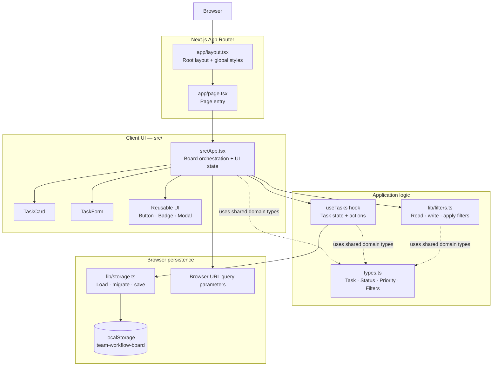
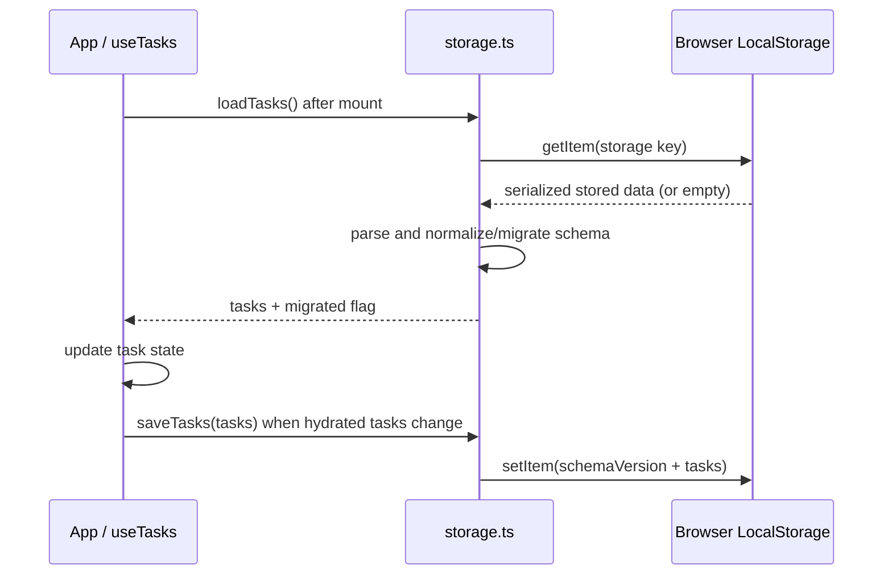

# Flowboard — Application Architecture

## 1. Overview

Flowboard is a client-side team task board built with **Next.js App Router, React, and TypeScript**. The Next.js app entry points live in `app/`, while the interactive board, reusable components, hooks, domain types, filtering, and persistence logic live in `src/`.

The board supports task creation, editing, deletion, status changes, filtering, sorting, search, browser URL filter synchronization, and versioned LocalStorage persistence.

## 2. High-level architecture



## 3. Request and data flow

### Initial load

1. The browser loads `app/layout.tsx`, which imports the global stylesheet, and renders `app/page.tsx`.
2. `app/page.tsx` renders the client-side board exported from `src/App.tsx`.
3. `useTasks()` initializes with seed tasks so the board has a safe initial state.
4. After the component mounts, `useTasks()` calls `loadTasks()` to read LocalStorage. It then updates task state and exposes whether a migration occurred or storage failed.
5. `App` reads filter values from the current URL query string and initializes its filter state.
6. Visible tasks are derived with `filterTasks()` and `useMemo()`.

### User interactions

- **Create:** `TaskForm` submits a typed task draft to `App`; `useTasks.add()` assigns an ID and timestamps, then updates task state.
- **Edit:** `TaskCard` calls the edit handler; `App` opens `TaskForm` with the selected task. `useTasks.update()` replaces the matching task and refreshes its `updatedAt` timestamp.
- **Move:** A card's move action calls `useTasks.move()` to update its status and timestamp.
- **Delete:** The delete handler calls `useTasks.remove()` to remove the task by ID.
- **Filter/search/sort:** `App` updates the `Filters` state. `filterTasks()` derives the visible list; the task collection itself is not mutated by filtering.
- **URL synchronization:** `readFilters()` initializes filter state from query parameters. `writeFilters()` serializes the current filters back into the browser URL using `history.replaceState()` after a short delay.

### Persistence flow



## 4. Main modules

| Path | Responsibility |
|---|---|
| `app/layout.tsx` | Next.js root layout, document metadata, and global CSS import. |
| `app/page.tsx` | App Router page entry; renders the board component. |
| `src/App.tsx` | Composes the board UI, owns filter/modal/drag state, connects task actions, and coordinates URL filter state. |
| `src/components/TaskCard.tsx` | Displays an individual task and exposes its edit, delete, and status-move interactions. |
| `src/components/TaskForm.tsx` | Task create/edit form. |
| `src/components/ui/Button.tsx` | Reusable button primitive. |
| `src/components/ui/Badge.tsx` | Reusable badge primitive. |
| `src/components/ui/Modal.tsx` | Reusable modal primitive. |
| `src/hooks/useTasks.ts` | Encapsulates task state, hydration, persistence effects, and add/update/move/remove actions. |
| `src/lib/storage.ts` | Seed data, LocalStorage access, schema normalization/migration, and versioned writes. |
| `src/lib/filters.ts` | Default filters, URL parsing/serialization, and task filtering/sorting. |
| `src/types.ts` | Shared TypeScript domain types (`Task`, `Status`, `Priority`, and `Filters`). |
| `src/styles.css` | Global application styles and responsive presentation. |

## 5. State ownership

| State | Owner | Notes |
|---|---|---|
| Tasks | `useTasks()` | Source of truth for task records; persisted to LocalStorage after hydration. |
| Migration status | `useTasks()` | Used by `App` to show a migration notice. |
| Storage error | `useTasks()` | Used by `App` to show a save error notice. |
| Search, status, priority, sort filters | `App` | Initialized from URL and serialized back to URL. |
| Form visibility and selected task | `App` | Controls create/edit modal state. |
| Drag-over status | `App` | Controls drag-and-drop visual feedback. |
| Derived visible tasks and summary values | `App` | Calculated from task and filter state; not separately persisted. |

## 6. Persistence schema and migration

The LocalStorage key is `team-workflow-board`. The current stored envelope is versioned:

```ts
{
  schemaVersion: 2,
  tasks: Task[]
}
```

The migration code normalizes legacy task records when loading data. In particular, it converts a missing or non-string `assignee` to an empty string, defaults missing `tags` to an empty array, and supplies missing `createdAt` / `updatedAt` timestamps. The loader reports `migrated: true` when the stored schema version is older than the current version. `App` displays a non-blocking notice for a migration, and `useTasks` writes the loaded tasks back in the current version after hydration.

## 7. Performance approach

- `useMemo()` is used to derive the visible task list from `tasks` and `filters` rather than recomputing it on unrelated renders.
- Task action callbacks in `App` use `useCallback()` so stable handlers can be passed to task cards.
- `TaskCard` is wrapped with `React.memo` so a card can skip rendering when its props are shallowly unchanged.
- These are optimization mechanisms, not proof of a measured speedup. Use React DevTools Profiler with the same interaction before and after the change, and record the observed commit/render results in the project notes.

## 8. Technology boundaries

- **Next.js App Router:** application entry and root layout.
- **React client components:** interactive board and browser-only behavior.
- **TypeScript:** shared domain contracts and typed component interfaces.
- **LocalStorage:** persistence for this browser; data is not synchronized across devices or users.
- **URL query parameters:** shareable/restorable filter state.
- **CSS:** styling and responsive layout.

## 9. Current limitations / future considerations

- LocalStorage is browser-local and is not a multi-user backend.
- Browser storage can be unavailable or full; the hook surfaces a storage error notice.
- Migration currently normalizes the legacy V1 task shape into schema V2. Future schema changes should add explicit migration steps and tests for each supported prior version.
- URL synchronization uses the browser History API. If changing this integration, verify query-string initialization, refresh persistence, Back/Forward behavior, and React DevTools profiling in the running Next.js app.
- Profiling notes should contain measured before/after observations from the actual browser session; do not report estimated improvements as measured results.
